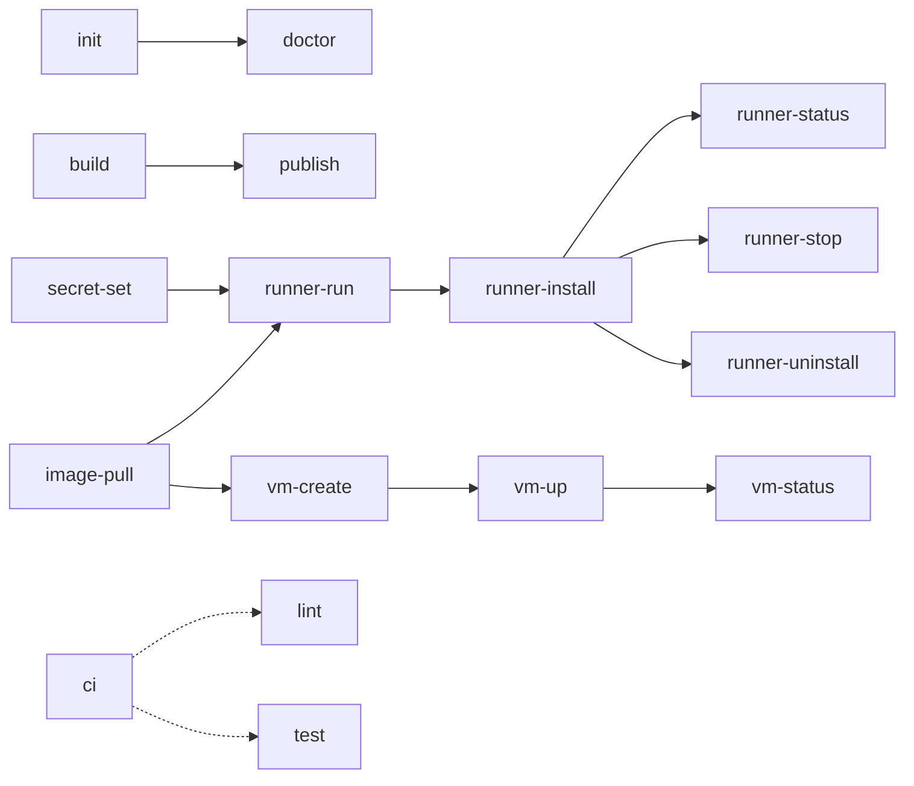

# Makefile Reference

The [`Makefile`](./Makefile) is the single source of truth for building the agent image
and running VMs cloned from it. Run `make help` for the quick target list; this file is
the narrative reference.

The same verbs work on both kinds of host. On a Linux host (the Linux runner image, see
[specs/linux.md](specs/linux.md)), `init`, `doctor`, `build`, `runner-*`, and
`secret-set` run the Linux side, and `host-setup` prepares the host; see
[Linux host](#linux-host). The Tart targets (`image-*`, `vm-*`, `publish`) are macOS only.

## Target overview

`runner-run` and `runner-install` are the normal way to run VMs: Claude's
orchestrator boots a fresh VM per session. `vm-up` (`vm-start` followed by `vm-configure`) gives a persistent VM for
debugging. Dotted arrows are independent gates.

## Variables

| Variable | Default | Used by |
| --- | --- | --- |
| `VM` | none (required) | all `vm-*` (`vm-create` refuses `runner-N`), optional for `secret-set` |
| `IMAGE_REF` | `agent-macos` (Linux: `agent-linux`), from `.env` | `image-pull`, `vm-create`, runner VMs |
| `RUNNER_MAX` / `RUNNER_MIN_IDLE` | `2` / `1` (from `.env`) | Runner VMs at most / kept booted as standby |
| `RUNNER_SPAWN_SECONDS` | `300` | The orchestrator's `--expected-spawn-seconds` lease |
| `ORCHESTRATOR_HEALTH_PORT` | `8080` | The orchestrator's `/healthz` on the host |
| `RUNNER_LABEL_PREFIX` | this Mac's `LocalHostName` | Runner label and guest hostname: `<prefix>-<vm>` |
| `VM_BOOT_TIMEOUT` | `300` | Seconds `vm-configure` waits for the guest agent |
| `VM_CPU` / `VM_MEMORY_GB` | `4` / `12` (Linux: `6` / `24`) | runner VMs, `vm-create` |
| `DIR` | where make started (`$(PWD)`, which `make -C` keeps) | `host-runner-run`, `host-runner-install`: the context directory |
| `HOST_RUNNER_HEALTH_PORT` | `8081` | The host runner's `/healthz` |
| `HOST_CLAUDE_CONFIG_DIR` | `CLAUDE_CONFIG_DIR`, else `~/.claude` | The host runner's Claude config directory (session config, lock account); `~/` or an absolute path. Read at `host-runner-run`/`-install` time from the command line or `.env` |
| `HOST_RUNNER_SHELL` | your login shell | The shell that sets up the host runner's environment |
| `MODE` | `run` | `doctor`: `run` or `build` |
| `NAME` | none | `secret-set`: `claude-environment-secret` |
| `LOG_LINES` | `100` | `vm-logs` |
| `REGISTRY` | from `.env` | `publish` |
| `PKR_VAR_base_image` | `ghcr.io/cirruslabs/macos-$(MACOS_CODENAME)-xcode:latest` | `build`, `test`; the codename comes from the host's macOS major version (`MACOS_CODENAME_<major>`); set it in `.env` to override |

Linux hosts only, from `.env` (see `.env.linux.example`):

| Variable | Default | Used by |
| --- | --- | --- |
| `LINUX_BASE_IMAGE` | `ubuntu:24.04` | `build`: the LXD image the build VM starts from |
| `BUILD_CPU` / `BUILD_MEMORY_GB` / `BUILD_DISK_GB` | `8` / `16` / `64` | `build`: the build VM |
| `LXD_POOL_GB` | 70% of the free space on `/` | `host-setup`: the ZFS pool (a sparse file) |

## Targets

### Develop

| Target | Description |
| --- | --- |
| `help` | List targets (default goal) |
| `init` | Creates `.env` from `.env.example` (Linux: `.env.linux.example`); runs `packer init` when Packer is installed |
| `doctor` | `triage` against `triage.yaml` for `MODE` (`run` or `build`). Read-only |
| `build` | `tart pull` the base image, `packer build` into `agent-macos-next`, then swap it into `agent-macos` so runner VMs never clone a half-built image |
| `lint` | `packer fmt -check`, `shellcheck`, `shfmt -d`, `plutil -lint` |
| `format` | `packer fmt`, `shfmt -w` |
| `test` | `packer validate` |
| `ci` / `pre-commit` | `lint` + `test`, what CI runs |
| `clean` | Removes `build/logs/`. Leaves `build/runners/`, where live runner VMs hold their names |

### Runners

| Target | Description |
| --- | --- |
| `runner-run` | `scripts/orchestrator-run.sh` in the foreground: Keychain secret into the environment, then `claude self-hosted-runner orchestrator --hooks-dir hooks`. Runner VMs outlive Ctrl-C |
| `runner-install` | `scripts/orchestrator-service.sh install`: host LaunchAgent `com.agent-images.orchestrator`; logs in `build/logs/orchestrator.{out,err}`. Over SSH, run `security unlock-keychain ~/Library/Keychains/login.keychain-db` first. The install and every orchestrator start clear Homebrew's quarantine on a Developer ID-signed `claude` |
| `runner-uninstall` | Boots out the orchestrator, then stops and deletes every runner VM |
| `runner-stop` | Stops and deletes every runner VM (sessions requeue); a running orchestrator boots replacements |
| `runner-status` | Orchestrator state, its `/healthz` body and log tail, then `vm-status` for each runner VM |

Each runner VM is its own launchd job, `com.agent-images.runner-N`, running
`scripts/runner-once.sh`. Claims live in `build/runners/runner-N/`. Logs, all on the
host so they outlive the VM:

Every LaunchAgent and job writes stdout to `.out` and stderr to `.err`.

| Logs (`.out` / `.err`) | What |
| --- | --- |
| `build/logs/orchestrator` | The orchestrator and every `spawn-runner` run |
| `build/logs/runner-N.runner` | `runner-once`: clone, configure, wait, delete |
| `build/logs/runner-N.guest` | The VM's `agent-runner` (the self-hosted runner and `brew upgrade`) and watchdog output, streamed while it runs; a `=== time runner-N order … ===` header per VM |
| `build/logs/runner-N.tart` | `tart run` output |

### Host runner (this Mac itself, no VM)

| Target | Description |
| --- | --- |
| `host-runner-run` | `scripts/host-runner-service.sh run`: from launchd's minimal environment, `cd $(DIR)`, start your login shell there, and run `scripts/host-runner-run.sh` in the foreground. It reads the secret (Keychain account `host-<context>`, else `host`), locks to the email of the Claude config directory's account, and runs `images/shared/runners/claude.sh` again after every session. Refuses when the LaunchAgent is installed |
| `host-runner-install` | The same command as LaunchAgent `com.agent-images.host-runner` (`KeepAlive`): starts at once in the GUI session and at every login. Runs `host-runner-run.sh --check` first, which fails on a missing secret but not on a keychain locked over SSH |
| `host-runner-uninstall` | Boots out the LaunchAgent, waits up to 130 s for the runner to drain, removes the plist |
| `host-runner-status` | LaunchAgent state, the running runner's context, `/healthz`, log tail |

A running host runner holds `build/host-runner/` (its PID and a summary of its
context), which keeps a second one from starting. LaunchAgent logs:
`build/logs/host-runner.{out,err}`.

### VMs (manual, persistent; for debugging)

| Target | Description |
| --- | --- |
| `image-pull` | `tart pull $(IMAGE_REF)` on run hosts |
| `image-prune` | `tart prune --entries caches --space-budget $(TART_CACHE_GB)` (default 200 GB). Each newer base image `make build` pulls adds ~80 GB to the cache; this drops the least recently used |
| `vm-create` | `tart clone` then `tart set --cpu --memory` |
| `vm-start` | `tart run --no-graphics` in the background; log in `build/logs/` |
| `vm-configure` | `scripts/vm-configure.sh`: hostname, secrets, `runner.env`, runner restart. Idempotent |
| `vm-up` | `vm-start` + `vm-configure` |
| `vm-stop` / `vm-delete` | `tart stop`; `tart delete` after stopping |
| `vm-status` | `scripts/vm-status.sh`: runner, process, Claude `/healthz`, last log lines |
| `vm-logs` | Tails a running guest's `~/Library/Logs/agent-runner.out` and `.err` |
| `vm-versions` | macOS, Xcode and its developer dir, iOS simulator runtimes, the guest user's iPhone simulators, and Claude Code in the guest |
| `vm-list` | `tart list` |
| `secret-set` | `scripts/secret-set.sh`: stores service `agent-images.<NAME>`, account `<VM>` or `default` (the host runner reads `host-<context>` or `host`). Prompts (hidden) or reads a pipe (`pbpaste \| make secret-set NAME=…`); sends the value to `security -i` over stdin (the `-w` prompt truncates at 128 characters) and checks it round-trips |

### Release / Danger

| Target | Description |
| --- | --- |
| `bump` | Bumps `version.txt`; `LEVEL=patch\|minor\|major` |
| `publish` | `tart push` to `$(REGISTRY)/agent-macos:v$(VERSION)`. Requires `CONFIRM_PUBLISH=1` |

## `make doctor`

Runs [triage](https://github.com/lolay/triage) against [`triage.yaml`](triage.yaml):
`MODE=run` (the default) uses its `default` profile, `MODE=build` its `build` profile,
and both extend a shared `host` profile. If `triage` itself is missing, `doctor` prints
`brew tap lolay/tap && brew trust lolay/tap && brew install lolay/tap/triage`. It's read-only, exits non-zero when a required
check fails, and prints the command that fixes each one, including Tart's tap-trust
step. It passes `--var image_ref=$(IMAGE_REF)` so the image check follows `.env`.

| Profile | Checks |
| --- | --- |
| `host` | Apple Silicon, `make`, `tart` ≥ 2.38, `security`, `.env` |
| `default` (run host) | `claude` (and, as a warning, that Homebrew's quarantine is off it), `vms/runner.env`, the Keychain environment secret, a login keychain this session can read (it stays locked over SSH), the `IMAGE_REF` image; FileVault state (info only) |
| `build` | `packer` ≥ 1.16.1, the Packer Tart plugin, `python3`, `shellcheck`, `shfmt`, `plutil` |
| `linux` (Linux host) | x86_64, VT-x/AMD-V, nested KVM, `make`, `.env`, `lxc`, a ZFS storage pool, the `IMAGE_REF` image, `claude`, `vms/runner.env`, the environment secret file, lingering |

## Linux host

| Target | On Linux |
| --- | --- |
| `host-setup` | `scripts/linux/host-setup.sh`: checks VT-x/AMD-V and turns on nested KVM, installs the LXD snap (refreshes held) and initializes it with a ZFS pool and the `lxdbr0` bridge, installs Claude Code, enables lingering. Idempotent; uses sudo |
| `doctor` | `triage --profile linux` (one profile; `MODE` is ignored) |
| `build` | `scripts/linux/build-image.sh`: refreshes LXD, launches `agent-linux-build` from `ubuntu:24.04`, runs `images/linux/scripts` in it (the SDK step boots the emulator once for its snapshot), publishes `agent-linux-next`, then moves the `agent-linux` alias to it |
| `runner-run` | `scripts/linux/orchestrator-run.sh`: the secret from `~/.config/agent-images` into the environment, then `claude self-hosted-runner orchestrator --hooks-dir hooks/linux` |
| `runner-install` | `scripts/linux/orchestrator-service.sh install`: systemd user unit `agent-images-orchestrator.service`, started at boot (lingering) |
| `runner-uninstall` / `runner-stop` / `runner-status` | As on macOS, with systemd and `lxc` |
| `secret-set` | `scripts/linux/secret-set.sh`: writes `~/.config/agent-images/<NAME>[.<VM>]` (mode 600). Prompts (hidden) or reads a pipe (`cat key.txt \| make secret-set NAME=…`), trims it, and checks it round-trips; the orchestrator checks the key's shape at startup |

Each runner VM is its own systemd user unit, `agent-images-runner-N.service`, running
`scripts/linux/runner-once.sh`, which launches an ephemeral LXD VM (deleted when it
powers off). Claims live in `build/runners/runner-N/`, as on macOS. Logs:

| Log | What |
| --- | --- |
| `build/logs/orchestrator.log` | The orchestrator and every `spawn-runner` run |
| `build/logs/runner-N.runner.log` | `runner-once`: launch, configure, wait, delete |
| `build/logs/runner-N.guest.log` | The VM's journal for `agent-runner` and the watchdog, streamed while it runs; a `=== time runner-N order … ===` header per VM |
| `build/logs/runner-N.lxc.log` | `lxc launch` output |

For a debug VM: `lxc launch agent-linux debug-1 --vm`, then
`scripts/linux/vm-configure.sh debug-1` (settings from `vms/debug-1.env`), and
`lxc exec debug-1 -- bash` to look around.

## CI alignment

| Workflow | Target |
| --- | --- |
| `.github/workflows/ci.yml` | `make init`, `make ci` on `macos-latest` |
| `.github/workflows/linux-image-smoke.yml` | Manual only: runs `images/linux/scripts` on `ubuntu-24.04` (which has KVM) and boots the emulator |

Image builds don't run in hosted CI: GitHub's macOS runners can't nest Tart VMs, and
the Linux image builds on its host like the macOS one. The Linux smoke test covers
the image's contents without LXD.
