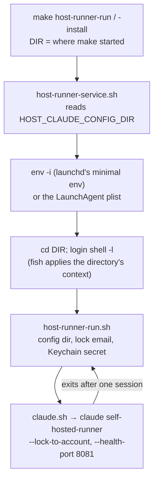

Adds a host runner: one Claude runner on the Mac itself, as the logged-in user, for sessions that need what a macOS guest can't give them (Apple Intelligence). It runs beside the VM runners on the same Mac or on its own. You start it with `make host-runner-run` (foreground) or `make host-runner-install` (a LaunchAgent, in the GUI session); to use it on demand over Tailscale, install it over SSH and uninstall it when you're done.

## Review guide

Review tier: [study], because it runs agent sessions as the host user, with that user's git, SSH keys and Keychain, and it changes `claude.sh` and `keychain_secret`, which the VM runners share.
Blast radius: VM runners only through the shared changes (defaults keep their behavior); the host runner itself is opt-in, and a revert is safe once `make host-runner-uninstall` has run.
Review time: ~15 min

1. [study] `scripts/host-runner-run.sh`: resolves config dir, lock account and secret; refuses the git proxy; reruns the runner after each session
2. [study] `scripts/host-runner-service.sh`: login-shell-in-a-directory launch, clean environment, LaunchAgent install/uninstall/status
3. [check] `images/shared/runners/claude.sh`: secret from the environment, new settings (shared with the VMs)
4. [check] `scripts/lib.sh`, `orchestrator-run.sh`, `orchestrator-service.sh`, `vm-configure.sh`: `keychain_secret` takes an account list; plist arguments XML-escaped
5. [skim] `Makefile`, `vms/example-host.env`, `.env.example`
6. [skim] `README.md`, `Makefile.md`, `specs/design.md`

## Validation

- `shellcheck -x` and `shfmt -d` on every script in the Makefile's list: pass
- Smoke test on Linux with fish 3.7, the public fish dotfiles, a stub context registry and stubbed `security`/`plutil`/`launchctl`/`dscl`/`claude`: context applied in a non-interactive `fish -l -c`; markers reached the runner; lock email and secret account `host-lolay` resolved; runner restarted after each exit; Ctrl-C stopped it and cleared the lock
- Same setup, failures and precedence: no secret fails install before the plist is written; a locked keychain only warns; `CLAUDE_USE_GIT_PROXY=true` refused; a second runner refused; config dir from the command line, then `.env`, then `CLAUDE_CONFIG_DIR`, then `~/.claude`; the override lands in the plist
- `make test` (`packer validate`): not run, no Packer here; CI runs it
- On a Mac: not run. Untested: Apple Intelligence from the LaunchAgent, `launchctl bootstrap gui/<uid>` over SSH, the runner handing its environment to sessions, and a VM runner session after the shared changes

## Rollback

Run `make host-runner-uninstall` on any Mac that has it installed (the plist points at a script the revert removes), then revert the squash commit. Nothing else persists apart from `~/agent-host-workspace` checkouts.

[study] The host runner

How it starts (both modes):

What it reads:

| What | From |
| --- | --- |
| Claude config dir (session config, lock account) | `HOST_CLAUDE_CONFIG_DIR` (command line or `.env`), else `CLAUDE_CONFIG_DIR`, else `~/.claude` |
| `--lock-to-account` | `CLAUDE_LOCK_TO_ACCOUNT` in `vms/host.env`, else that dir's `oauthAccount.emailAddress`; required |
| Secret | Keychain account `host-<fish context>`, else `host`; never `default` |
| Refused | `CLAUDE_USE_GIT_PROXY=true`, `CLAUDE_CONFIGURE_GIT=true` (both rewrite `~/.gitconfig`) |

Error handling: misconfiguration exits before the runner starts; a nonzero runner exit backs off 30 s; SIGTERM/SIGINT forward to the runner, which drains and pushes; a lock in `build/host-runner/` stops a second runner on the same Mac.

[check] Shared with the VM runners

| Contract | Before (`1c20302`) | After |
| --- | --- | --- |
| `keychain_secret` | `<name> <vm>`: tries `<vm>`, then `default`; returns 1 | `<name> <account>...`: tries each; returns 2 if none has it, 1 otherwise |
| `claude.sh` secret | `~/.claude-runner/environment-secret` | `SELF_HOSTED_RUNNER_ENVIRONMENT_SECRET` when set, else the same file |
| `claude.sh` settings | base dir fixed at `~/workspace`; always upgrades | `CLAUDE_BASE_DIR` (default `~/workspace`), `CLAUDE_HEALTH_PORT` (default empty = 8080), `CLAUDE_UPGRADE` (default `true`) |

The three existing callers pass `default` explicitly, so VM lookups are unchanged. `write_host_plist` now XML-escapes arguments (the launch command holds quotes and user paths).

Decisions

- No orchestrator on the host: there's no VM per session to start or clean up, and a session running as the host user can read the Keychain anyway. A restart loop plus `--remove-session-state` covers it.
- Your own user, not a second macOS account: a second account is a hassle and may not get Apple Intelligence. That means no git proxy, so sessions push with your SSH key.
- A LaunchAgent, not a process started from SSH: Simulator and Apple Intelligence need the GUI session. Install and uninstall over SSH gives you on-demand use.
- `.env` resolved when you install and written into the plist: an installed agent's lock account doesn't change at its next restart because someone edited `.env`.
- One `.env`: the host keys are prefixed `HOST_`; the settings that reach sessions are already split between `vms/runner.env` and `vms/host.env`.

https://claude.ai/code/session_01BNKwNZ1PYZRAyUMALKyQCj

Assisted-by: Claude Code
