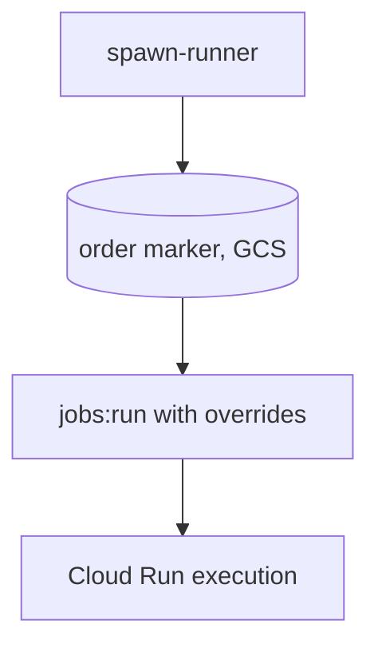
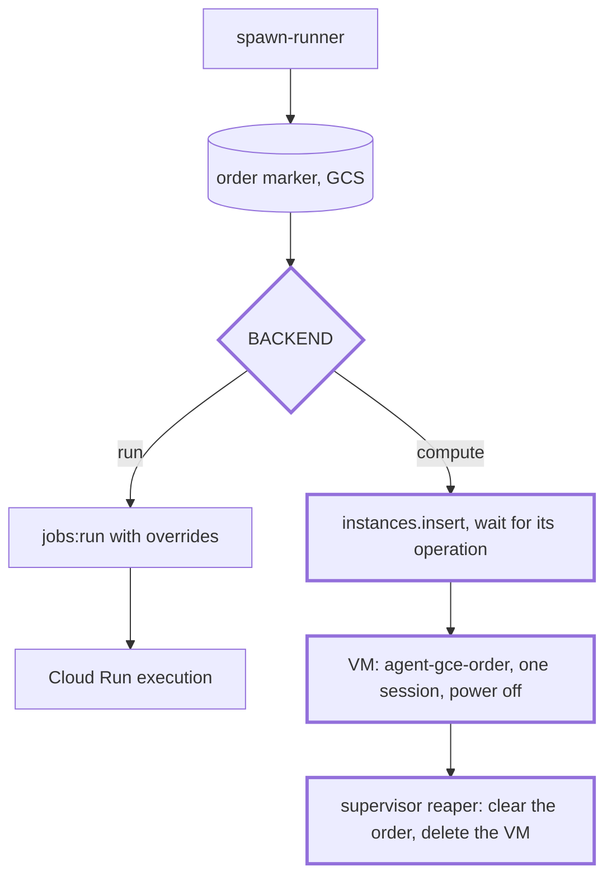

Adds the `android` runner type on Google Cloud, the Android half of m2 in `specs/gcp.md`. Cloud Run has no KVM, so each session is a Compute Engine VM with nested virtualization, from a Packer image built with the LXD image's own scripts. The hook creates the VM with the work order in instance metadata, the guest reads it at boot and serves one session, and a reaper in the orchestrator container deletes the VM afterwards. Plan: `specs/handoffs/plan-gcp-android-kestrel.md` (s1 to s6 here; s7 and s8 are the deploy and the session test).

## Review guide

Review tier: [study], because it adds a backend to the spawn hook, a new metadata contract between hook, guest and reaper, and a deploy job that creates and deletes GCP images and VMs.
Blast radius: `linux` and `gis` spawns go through the same hook (the Cloud Run branch is unchanged and its tests pass). Merging builds the image and boots a smoke VM, about $0.50. A revert is safe, but stopped VMs need deleting by hand afterwards (Rollback).
Review time: ~35 min. That's over 30, but a split doesn't help: the hook needs the image, and the image's guest flow needs the hook's metadata. s1 to s5 are separate commits.

1. [study] [`hooks/gcp/spawn-runner`](https://github.com/lolay/agent-images/compare/main...claude/youthful-dijkstra-09v7kk#diff-d55d84a6c00a97f4b35fc94450ad76c6cdc1b30877742aa473100fd750189a8f), [`lib.sh`](https://github.com/lolay/agent-images/compare/main...claude/youthful-dijkstra-09v7kk#diff-d3a896346666abbb21d9ac8428e17793c525b995d6c602d6135e8ea9ec20d250): the `compute` branch, its exit codes, the instance body
2. [study] [`images/android/gce/files/agent-gce-order.sh`](https://github.com/lolay/agent-images/compare/main...claude/youthful-dijkstra-09v7kk#diff-6aa1fe09c244f6af2a237c5090d72b5ccf33192ee531400dcff1c54e02ef7f60), [`.service`](https://github.com/lolay/agent-images/compare/main...claude/youthful-dijkstra-09v7kk#diff-395d16ef2935611d9530dd1e94ecec558718711a7a5ae9af5bd873fae1e1bf9b): the guest reads the work order (root, at boot)
3. [study] [`images/cloud/orchestrator/supervisor.sh`](https://github.com/lolay/agent-images/compare/main...claude/youthful-dijkstra-09v7kk#diff-86b923fda9ba7c1579777c90696a730322c7eb7470fc44c73b5199bac50fc50e): the reaper, which deletes VMs
4. [check] [`scripts/cloud/deploy.sh`](https://github.com/lolay/agent-images/compare/main...claude/youthful-dijkstra-09v7kk#diff-634b57be036d9d58e069417e4ade204ad943b2786d0a47d3a7790e2e43189c66), [`changed-targets.sh`](https://github.com/lolay/agent-images/compare/main...claude/youthful-dijkstra-09v7kk#diff-6547ddd6a038244352114699ea1f420c67c77ddc91b1fa8ba17c43cbbe24b9ff), [`cloud-deploy.yml`](https://github.com/lolay/agent-images/compare/main...claude/youthful-dijkstra-09v7kk#diff-87020c72ebdd73ecb05e14a3673b1a63b4cb58fd96acea002a0f9dc91885bc7e): `vm-build`, `vm-promote` (smoke VM, family move, keep one), prune
5. [check] [`images/android/gce/build.pkr.hcl`](https://github.com/lolay/agent-images/compare/main...claude/youthful-dijkstra-09v7kk#diff-a9e222373176a4abd4f557a9a7762196c5f1dc2003cd28623bc5bb94618431fc), [`provision.sh`](https://github.com/lolay/agent-images/compare/main...claude/youthful-dijkstra-09v7kk#diff-c5485cee54c37d8a4df4d4748c866630eaeb69b52aa5e6b89c2a2fe484f23d90), [`agent-gce-smoke.sh`](https://github.com/lolay/agent-images/compare/main...claude/youthful-dijkstra-09v7kk#diff-24077a2d000c86542e8f49bd0c498713bf03d97a94a5f94266b4070dc340e7ac), [`infra/gcp/android.env`](https://github.com/lolay/agent-images/compare/main...claude/youthful-dijkstra-09v7kk#diff-ed470b64a09896eefa2b6a923f1981e119f04d49e695856cbd6a8c6e8ce73c9f)
6. [check] [`tests/unit/test_changed_targets.py`](https://github.com/lolay/agent-images/compare/main...claude/youthful-dijkstra-09v7kk#diff-9c59cec38b6dbced4b5b5f1642b51fbd97d88e1db3e43bd97990e2ab057e98fa): expected outputs gain `"vms": []`; one inherited case skipped for the compute fixture
7. [skim] the other tests ([`fake_gcp.py`](https://github.com/lolay/agent-images/compare/main...claude/youthful-dijkstra-09v7kk#diff-fc6c8865bbec9657e9bd7abf7b7d4b1455f874335e0579ba819313c333dd9079), `test_gce_order.py`, `test_spawn_runner.py`, `test_supervisor.py`, `test_deploy.py`), `Makefile`, `cloud-build.yml`, the journald and profile drop-ins
8. [skim] [`specs/gcp.md`](https://github.com/lolay/agent-images/compare/main...claude/youthful-dijkstra-09v7kk#diff-fc114caed302857ba31cdac6577a99dfcfa67c70382c6f74172f4cb17baddbd3), `gcp-infrastructure.md`, `Makefile.md`, README, the session `CLAUDE.md`, the plan and handoff

## Validation

- `make cloud-test`: pass, 160 tests, 1 skipped (on purpose)
- `make cloud-lint`: pass (shellcheck, shfmt, `packer fmt -check`, `packer validate` with googlecompute 1.2.9)
- actionlint on every workflow: pass
- not run: the orchestrator image build (it bakes in the changed hook, supervisor and `android.env`). This container has no Docker daemon; the pull request's `cloud-build` check builds it
- not run: the Packer build, the smoke VM, any GCP call, `tests/sessions/android.md`. They need this merged (only `main` deploys) and they cost money: m2.s7 and s8
- not run: `android-image-smoke`. `images/android/scripts` didn't change; only the session `CLAUDE.md` text did

## Rollback

Revert the squash commit. The next deploy rebuilds the orchestrator without `android`, and prune deletes the `agent-android*` images. The reaper goes with the revert, so delete any leftover VMs by hand: `gcloud compute instances list --filter labels.agent-images-type=android`, then delete what it lists. Running ones go anyway at their 9 h 30 min `maxRunDuration`.

[study] Contracts

| Contract | Before | After |
| --- | --- | --- |
| `infra/gcp/<type>.env` | Cloud Run settings | `BACKEND` (`run` by default, or `compute`), plus `MACHINE_TYPE`, `DISK_GB`, `DISK_TYPE`, `IMAGE_FAMILY`, `MAX_RUN_DURATION_SEC` for `compute` |
| `changed-targets.sh` output | `{types, orchestrator, prune}` | adds `vms: [{type}]` (compute types whose image needs a build); `types` stays Cloud Run only |
| Instance metadata (hook to guest) | none | `work-order`, `runner-env` (plain `KEY=value` lines only), `agent-smoke`, `agent-debug` |
| Guest attributes (guest to reaper or deploy) | none | `agent-images/order=read`; `agent-images/smoke`, `smoke-log`, `emulator-boot-sec-{cold,warm}`, `nproc` |
| Labels | jobs only | VMs and images: `managed-by`, `agent-images-type`, plus `agent-images-order` on VMs and `agent-images-role=smoke` on smoke VMs |

Exit codes for `compute`: 409 or `RESOURCE_ALREADY_EXISTS` returns 0. Quota, capacity and rate limits return 1, whatever their status. Any other 403 or 404, and `RESOURCE_NOT_FOUND` (no image family yet), return 2. An insert still running after 40 s returns 0 and keeps the marker.

[check] Spawn flow, before and after

**Before** (base `ecc54c2`)

**After**

Decisions

- The reaper removes the work-order key, not the guest (agreed at the plan's STOP). If the guest deleted it, `agent-runner` would need `compute.instances.setMetadata`, and granted project-wide that would let one session rewrite another session VM's `startup-script`.
- The image is promoted with `images.patch` (`family`), not copied: it builds into `agent-android-next`, and only an image whose smoke VM passed reaches `agent-android`.
- The smoke VM times two emulator boots (a disk still restoring from the image, then warm), so every build measures the open question.
- VM names use the whole order id, so a 409 really means "this order's VM".
- Scratch is `/scratch` on the boot disk. Outputs and datasets aren't mounted on the VMs yet (open item in `specs/gcp.md`).
- The reaper runs as a background child of the supervisor, so a hung API call can't delay `SIGTERM` past the host's 85 s.

🤖 Generated with [Claude Code](https://claude.com/claude-code)

https://claude.ai/code/session_01BNKwNZBLaQvQVpJyiXVLDS

Assisted-by: Claude Code
