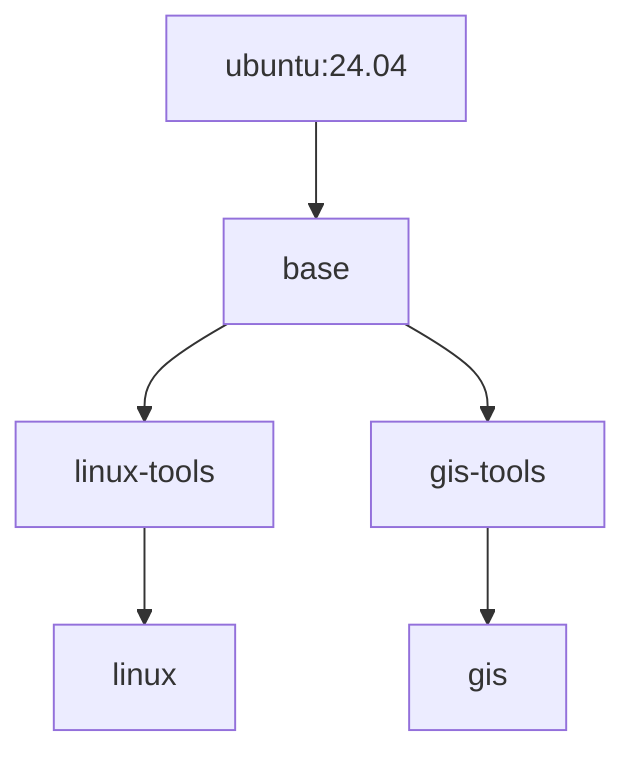
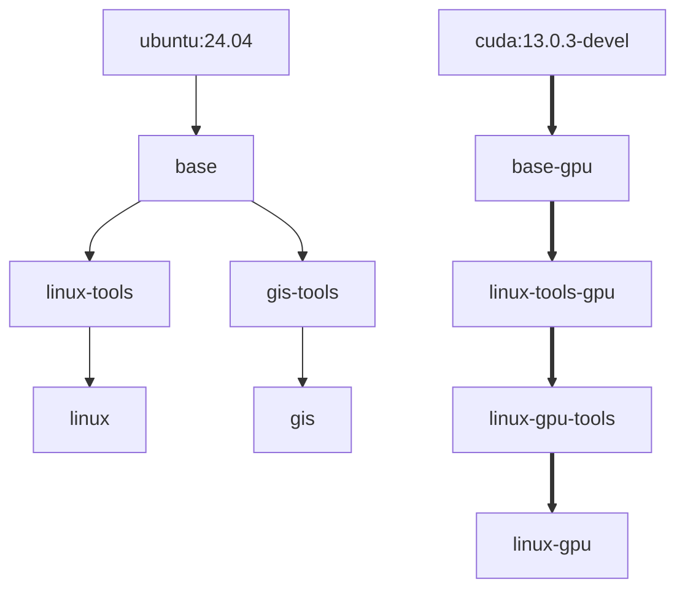

m3's first half (specs/gcp.md, "m3 - GPU types"): the `gpu` toolset and a `linux-gpu` runner type on an L4, built and checked locally, waiting for its first deploy. `linux-gpu` is `linux`'s own Dockerfile on CUDA 13.0's devel image, plus a `gpu` toolset that routes EGL, Vulkan and VirtualGL to the driver Cloud Run mounts. Its smoke reports which of the driver's libraries Cloud Run actually mounts, which is the open graphics question. Plan: `specs/handoffs/plan-gpu-types-ember.md` (s1 to s5 of s11).

## Review guide

Review tier: [study], because `infra/gcp/<type>.env` gains `GPU_TYPE`, which `job-spec.sh` renders into a billed GPU job.
Blast radius: only the new `linux-gpu` job and its orchestrator. `linux` and `gis` render byte-identical job specs and keep their cache settings. A bad `linux-gpu` image fails its own smoke and isn't promoted. Revert is safe: the deploy deletes a job whose env file is gone.
Review time: ~15 min

1. [study] [`infra/gcp/linux-gpu.env`](https://github.com/lolay/agent-images/compare/main...claude/vigilant-tesla-m2ipbw#diff-a9487c30a9ad1542e6e7ea5c82f0f671cf578dcdcdcc6c58ddc5ebb08a51ffe4), [`scripts/cloud/job-spec.sh`](https://github.com/lolay/agent-images/compare/main...claude/vigilant-tesla-m2ipbw#diff-f6030bc41c4bf61cd503be3bfc69d380eddd7c31e6fda67f8e8296960709d9b0), [`tests/unit/test_job_spec.py`](https://github.com/lolay/agent-images/compare/main...claude/vigilant-tesla-m2ipbw#diff-40e954b4ac0d6d56c3dc6bfeeffd654d33c7ead1bb760681bdca60751854b65e): `GPU_TYPE` adds one GPU
2. [check] [`.github/workflows/cloud-deploy.yml`](https://github.com/lolay/agent-images/compare/main...claude/vigilant-tesla-m2ipbw#diff-87020c72ebdd73ecb05e14a3673b1a63b4cb58fd96acea002a0f9dc91885bc7e), [`cloud-build.yml`](https://github.com/lolay/agent-images/compare/main...claude/vigilant-tesla-m2ipbw#diff-64990e1881d393d21b12b347f88b51be46ae77ca42e9db2bc8d2b230c57b3c06): no Actions cache for `-gpu` types; `linux-gpu` in the PR build
3. [check] [`images/cloud/docker-bake.hcl`](https://github.com/lolay/agent-images/compare/main...claude/vigilant-tesla-m2ipbw#diff-6879d3b56a504b09f7863e3843ca1fb420410741ed5aa03471f2f5aef4346fd2), [`base/Dockerfile`](https://github.com/lolay/agent-images/compare/main...claude/vigilant-tesla-m2ipbw#diff-cb081bf0498648e21c9fdd0995408ac8ccd6e5ddc655ebcb7dd9965186051099), [`linux-gpu/Dockerfile`](https://github.com/lolay/agent-images/compare/main...claude/vigilant-tesla-m2ipbw#diff-4eaa71fdf3fdf8a756f4f3fcd21f31831d2d6e9c42aebe148135832ccf61cd75), [`images/toolsets/gpu/install.sh`](https://github.com/lolay/agent-images/compare/main...claude/vigilant-tesla-m2ipbw#diff-96c9199a301299bb5a32755b93c93f6e6854fd5ae69df680765b7148eed5a21f) and its lists: the build graph and the `gpu` toolset
4. [check] [`images/toolsets/gpu/check.txt`](https://github.com/lolay/agent-images/compare/main...claude/vigilant-tesla-m2ipbw#diff-6b0d8c973c3d6ad62a55908855756de95e37f77e41adf04659796707f2916461), [`agent-gpu-libs.sh`](https://github.com/lolay/agent-images/compare/main...claude/vigilant-tesla-m2ipbw#diff-d0c3fd3125f475ada14b6f64e876e0e1275fb284d27afb8a741eb9b54b339591), [`cuda-probe.cu`](https://github.com/lolay/agent-images/compare/main...claude/vigilant-tesla-m2ipbw#diff-8beb290ca5adafee030ce7dcdc015d0d8113f9dba56e3a866e1f2eb08b1599e7), [`tests/unit/test_gpu_libs.py`](https://github.com/lolay/agent-images/compare/main...claude/vigilant-tesla-m2ipbw#diff-c7e6d4b62c3f55e5ccf3967600a4037a36f0b3c070597c6dcc978dc03ec97caf): the GPU smoke
5. [skim] [`specs/gcp.md`](https://github.com/lolay/agent-images/compare/main...claude/vigilant-tesla-m2ipbw#diff-fc114caed302857ba31cdac6577a99dfcfa67c70382c6f74172f4cb17baddbd3), [`specs/image-toolsets.md`](https://github.com/lolay/agent-images/compare/main...claude/vigilant-tesla-m2ipbw#diff-e57b0c224948015a9ef515ca022dc445c00321319e2326d3227f705c96992fe7), `images/toolsets/gpu/CLAUDE.md`
6. [skim] [`specs/handoffs/handoff-m3-gpu-types.md`](https://github.com/lolay/agent-images/compare/main...claude/vigilant-tesla-m2ipbw#diff-fe21567f8e9ebec845444005ef39ec7f9c1949bee80f58544f7bb54d7cf82ca7), [`plan-gpu-types-ember.md`](https://github.com/lolay/agent-images/compare/main...claude/vigilant-tesla-m2ipbw#diff-bd25aaac64cb232854ed6d9d7e27191add64b14be7fb65b241d46d3a65de598b), [`infra-ask-m3-gpu.md`](https://github.com/lolay/agent-images/compare/main...claude/vigilant-tesla-m2ipbw#diff-6825598c3edfdab7fdedeefbff7748c3c5f0efb668107ac0c9624805148b24eb), the session handoff; `handoff-m2-gis-android.md` removed (m3's replaces it)

## Before merging

1. `e2-small` for the orchestrator host (lolay/infrastructure), before step 2: a fourth orchestrator on the `e2-micro` leaves about 270 MiB.
2. The "Agent: Linux (GPU)" environment in claude.ai and the `claude-env-linux-gpu` secret. The GPU quota should need nothing: the first deploy is granted 3 L4s automatically.

## Validation

- Unit tests: pass, 179 (1 skipped), including 6 new
- actionlint, shellcheck, shfmt on the changed workflows and scripts: pass
- `linux` and `gis` job specs: byte-identical before and after
- Local build of `linux-gpu-tools` on CUDA 13.0.3: built. Checked in the image: the `ubuntu` user, nvcc 13.0, the probe's sm_89 and sm_120 SASS and sm_120 PTX, VirtualGL 3.1.5, both vendor files, and the smoke checks with Xvfb (EGL and Vulkan report llvmpipe with no GPU, as expected). Built with this session's TLS proxy CA in a scratch base image; CI doesn't need that.
- Not run: anything on a GPU (no GPU here; the first deploy's smoke is the first run, plan s6); the `linux-gpu` runner stage (Claude's layer) locally; the Packer half of `make cloud-lint` (no packer here, and nothing Packer changed)

## Rollback

Revert the squash commit. The next deploy deletes `agent-linux-gpu` and its `-next` job (the env file is gone), and the orchestrator image drops the type.

[study] The env file's new key

| `infra/gcp/<type>.env` | Before | After |
| --- | --- | --- |
| `GPU_TYPE` unset | CPU job | Unchanged, byte for byte |
| `GPU_TYPE=nvidia-l4` or `nvidia-rtx-pro-6000` | n/a | `nodeSelector.accelerator`, `gpuZonalRedundancyDisabled: true`, limit `nvidia.com/gpu: "1"` |
| Anything else | n/a | `job-spec.sh` exits 2 (`nvidia-14` is the classic typo) |

Field names are from Cloud Run's v2 REST reference. One GPU is the only count Cloud Run takes, so there's no `GPU_COUNT`. `CPU` and `MEMORY` must meet the GPU's minimums (L4: 4 and 16Gi; RTX PRO 6000: 20 and 80Gi), which the API enforces.

[check] Build graph and deploy cache

Before:

After:

`base-gpu` is `base/Dockerfile` with `BASE_IMAGE` set to CUDA. `linux-tools-gpu` is `linux/Dockerfile` on it, so `linux-gpu` can't drift from `linux`. `linux-gpu/Dockerfile` adds only the `gpu` toolset and `NVIDIA_DRIVER_CAPABILITIES=all`. `changed-targets.sh` follows `FROM agent-linux` with no change.

Deploy cache: the six `cache-from`/`cache-to` lines per type move into a step that writes them for CPU types and nothing for `-gpu` ones. `linux` and `gis` get exactly the lines they had. Main's scheduled no-cache rule (#36) is kept, and `linux-gpu` is `REBUILD=weekly`.

`gpu/install.sh` downloads VirtualGL's newest release `.deb` from GitHub with no checksum, the same trust as the Homebrew installer.

[check] The GPU smoke

Must pass: `nvidia-smi`, `agent-cuda-probe` (a kernel that runs and checks its result), `nvcc`. Report-only (pass either way, and print what they found): EGL renderer, Vulkan device, VirtualGL, and `agent-gpu-libs`, which prints the driver version and which library groups the host mounted (compute, EGL, GLX, Vulkan, NVENC, NVDEC, OptiX). So the first deploy's log answers whether Cloud Run can render on the GPU before any session runs. A local `make cloud-smoke` of a GPU type fails without a GPU.

Decisions

- One base Dockerfile with `BASE_IMAGE`, not gcp.md's separate `base-gpu/Dockerfile`: no drift between `linux` and `linux-gpu` (Gary).
- The `gpu` toolset is the last layer of each GPU type, not in the base: s2 to s7 iterate on it, and low in the stack each change would rebuild every toolset above it (Gary).
- CUDA code for sm_89 and sm_120 plus PTX, so the L4 runs the same images (Gary).
- No Actions cache for `-gpu` types: the cache is 10 GB per repo and CUDA is 4 GB of it. About 12 to 15 minutes from scratch (Gary). Raising the limit ($0.07 per GB-month over 10 GB) would let them cache.
- `NVIDIA_DRIVER_CAPABILITIES=all`: CUDA's image asks for `compute,utility`, which under NVIDIA's container toolkit leaves out the graphics libraries.
- The plan, its session handoff and the infra ask stay in `specs/handoffs/` until m3 closes (s11), as m2's plan did across its PRs.

Assisted-by: Claude Code
