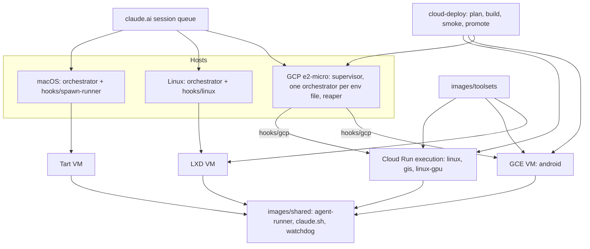

Full review of `main` at 506a1b9 (m1, m2 and m3's first PR, lolay/agent-images#37), the repo's first. Register: `2026-11-06-r1-full-findings.md`.

## Review guide

Review tier: [skim], records only; the decisions below are the reading.
Verdict: 1 high, 6 medium, 24 low, 3 info; 11 decisions for you, 2 of them medium. The verifier dropped none and lowered 19.
Review time: ~8 min

## Fix now

- r1.f1 high: Linux runners never run `claude update`; the shared runner takes the Homebrew cask branch whenever `brew` exists, so weekly types run a Claude up to a week old
- r1.f5 medium: the cloud smoke's I/O checks can't fail, so a broken outputs mount is promoted
- r1.f6 medium: rebuilding the same commit the same day deletes the live android image, and sessions fail until promotion
- r1.f2 medium: types are declared in four places; the PR check can't see a new one (matters for `3d-gpu`)
- r1.f9 medium: the shared runner scripts every platform runs have no tests (r1.f1 lives there)

## Decisions for you

1. **r1.f15 Actions in the credentialed deploy jobs are pinned by tag.** Now: tags, no Dependabot, design.md calls tags a supply-chain guard. Proposed: full SHAs with the tag as a comment, plus Dependabot. Options: SHA-pin all (recommended), only the non-immutable ones, or keep tags and fix the doc.
2. **r1.f10 The orchestrator is promoted with no smoke.** Now: bake, then straight to the host, nightly with the latest Claude. Proposed: check the pushed image's `orchestrator --help` lists every flag the supervisor passes. Options: that check (recommended), a full smoke, or accept.

Nine low and info decisions are in the collapsed block below.

## Rules changed

- Proposed for `AGENTS.md`: "A setting, list or default more than one script needs lives in one helper or file; don't copy it." Six findings are this class: r1.f2, f19, f27, f28, f33, f34.
- Proposed for `AGENTS.md`: "A test fake rejects what the real API would reject." r1.f10, f11, f14.

## Architecture

Three backends share one runner (`images/shared`) and one toolset installer. The cloud image is the only consumer of the toolset records (r1.f27), and the set of types lives in four places (r1.f2).

Decisions, low and info

| Finding | Now | Recommendation |
| --- | --- | --- |
| r1.f3 | A failing type holds back orchestrator deploys | Supervisor waits for a type's job or family; orchestrator depends only on `plan` |
| r1.f12 | Unit tests only on path-filtered PRs; `make test` help is wrong | Fix the help; run `cloud-test` before deploy |
| r1.f18 | Ubuntu 24.04 everywhere, no reason recorded | Record the CUDA 13.0 constraint |
| r1.f20 | `DISK_GB`/`IMAGE_FAMILY` edits don't rebuild the image | Decouple: fixed image disk, hook refuses a smaller `DISK_GB` |
| r1.f21 | No way to pin Claude on GCP | Leave to m4, and say so in gcp.md |
| r1.f23 | macOS VMs keep SSH admin/admin, unused | Disable Remote Login at the end of the build |
| r1.f24 | Debug VMs get the orchestrator's key by default | Require a per-VM key for a separate environment |
| r1.f25 | Any session can overwrite others' outputs | `objectCreator` + `objectViewer` |
| r1.f31 | Android build drivers disagree on the stderr gate | One policy across all three |

Details by dimension

- **Architecture** (f1 to f4): drew the three backends from the code. The `linux-gpu` CLAUDE.md says "no GPU" (f4).
- **Hotspots** (f5 to f8): the ten most-churned files read line by line. Also: removed compute types leak powered-off VMs (f7), and a hung smoke can bill 9.5 h (f8).
- **Tests** (f9 to f14): 179 tests pass, 1 skipped. Gaps: deploy's error path (f11), host runner scripts (f13), an empty `:run` body (f14).
- **Dependencies** (f15 to f18): every Action and base image is on its newest release. Packer is at two versions (f16), the linters at two (f17).
- **Contracts** (f19 to f22): two runner-settings paths with different defaults (f19); a missing env key retries forever (f22).
- **Security** (f23 to f26): the work-order and secret paths held up. The Tart cross-VM attack didn't survive verification: Tart's NAT isolates VMs.
- **Duplication** (f27 to f34): the toolset records' readers, `JAVA_HOME`, the quarantine check, the stop timeout, a stale test fixture (f32, needed before `3d-gpu`), env parsing, the Anthropic toolset list.

Not covered: the macOS guest provisioners, Terraform in lolay/infrastructure, per-toolset install scripts.

Assisted-by: Claude Code
