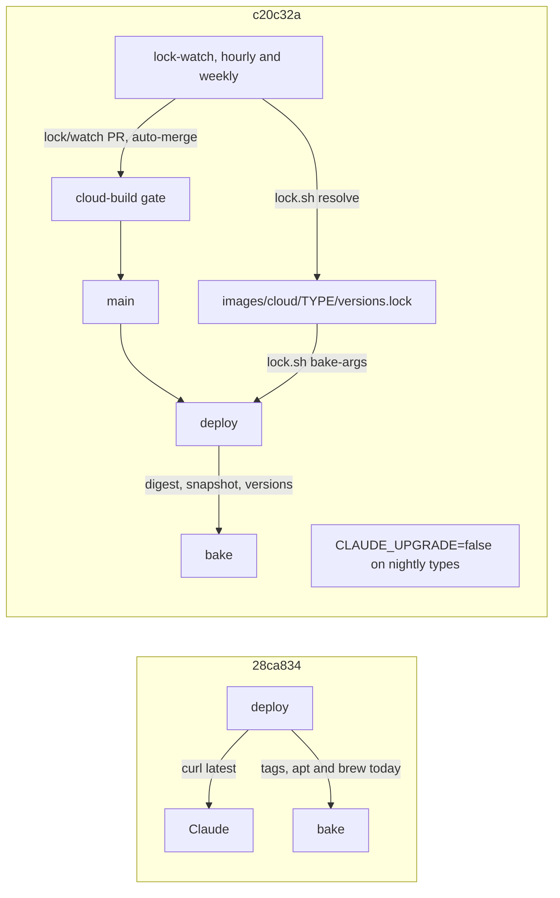

Incremental review of `main` from 28ca834 to c20c32a (30 commits, 6,770 changed lines), following r2. Covers m5 (lolay/agent-images#54, #56, #71: every runner type built from its lock, the lock watch and its bot), r2's remediation (#52, #53) and the bot's first lock pull requests. Register: `2026-11-12-r3-incremental-findings.md`.

## Review guide

Review tier: [skim], records only; the decisions below are the reading.
Verdict: 5 medium, 14 low, 3 info; 4 decisions for you. Nothing high. The verifier dropped 1 of 24 and merged 1.
Review time: ~7 min

m5 works: the bot has landed ten linux lock pull requests on its own. The gaps are at its edges. A carried candidate can revert a lock someone changed on `main`, every linux bump rebuilds linux-gpu, and the guards that keep the bot's token and the lock honest have no failing test. All 15 of r2's fixes hold under mutation.

## Fix now

- r3.f1 medium: the watch's carry reverts a lock changed on `main` while a lock pull request is open (a re-lock, or gcp.md's rollback)
- r3.f2 medium: r2.f9's fix makes the supervisor exit on a `DEPLOY=false` compute env file, and an env-only change reaches the host, so every orchestrator goes down
- r3.f10 medium: every `linux` lock bump also rebuilds and pushes uncached `linux-gpu` (a parent's lock counts as the child's input)
- r3.f13 medium: the propose job's link refusal, the only thing between a symlinked "lock" and the bot's token, has no test
- r3.f14 medium: nothing checks the lock's rust, terraform, tflint and VirtualGL versions reach the build; drop an `ARG` and the suite stays green

## Decisions for you

1. **r3.f8 What `~> x.y` means for Terraform.** Now: the lock reads it as the x.y line; tenv, `scripts/anthropic/setup.sh` and gcp.md's pin table read it as >= x.y, < (x+1).0. Options: tenv's meaning (recommended), or keep the line meaning and say so in the pin table.
2. **r3.f12 Which pins the watch tracks.** Now: apt pins lose their issue URL, Homebrew pins and Claude `stable` aren't listed, though gcp.md says every pin is. Recommended: carry apt's `# pinned:` note into the lock; correct gcp.md for Homebrew and `stable` (a channel the watch follows).
3. **r3.f18 Lock resolve tests in a session** (info). Now: 22 tests skip without docker and fail with Homebrew's buildx. Recommended: skip on `docker buildx version`, pass `DOCKER_CONFIG`, and add docker to the session doctor.
4. **r3.f22 Does the orchestrator follow a Claude pin?** (info) Now: it always takes `latest`, by design; bake.sh and the Makefile restate the default. Recommended: no; say so beside the bake variable and drop bake.sh's copy.

## Since last review

Also in range: one helper for per-type settings (`gcp_type_setting`, r1.f33 in part), the gh shim first on PATH (#67, #68, #76), apt failing on any failed download (#77), Actions runners held on 24.04 (#79), gis at 100 GiB of scratch (#65).

## Rules changed

- Proposed, `AGENTS.md` "Tests that can fail": a pull request that adds a guard names in its review guide the mutation that turned its test red. The rule landed in r2 and recurred five times here (r3.f13 to f17), all from m5's guards.
- Recurred, no new rule: "Test fakes" (r3.f17, a docker fake that skips the script it stands in for) and "One source per fact" (r3.f19 to f22).

Fix review

| Finding | Was | Now | By |
| --- | --- | --- | --- |
| r1.f21 | open | fixed | m5 (#54, #56): nightly types run the locked Claude with `CLAUDE_UPGRADE=false` |
| r1.f12, f16, f18, f27, f33 | open | open, partly fixed | #71 (gate required), #61 (Packer 1.16.2), #79 (runners), #52, #54; what's left is in each `Resolution:` |
| the other 19 of r1 | open | open | code unchanged at their locations |
| r2.f1 to f10, f12 to f15 | open | fixed | #52, #53, #54; each guard's test goes red when the guard is broken |
| r2.f11 | open | fixed | decided on #51, done by #52; seen in two deploys |
| r2.f16 | open | accepted | the Owner's decision on #51 |

r1 now reads 10 fixed, 24 open; r2 reads 15 fixed, 1 accepted. r2.f9's fix opened r3.f2. No fix claims were waiting in `specs/reviews/r*/` (#52 and #53 predate them).

Details by dimension

- **Correctness** (`/code-review xhigh` on the range; f1 to f9): besides f1 and f2, bake.sh builds with a partial lock (f3, a green PR then a red deploy); a bake-args change rebuilds nothing (f4); the watch's Close step can fail green (f5); `lock.sh diff` misjoins under en_US.UTF-8 (f6, shown with `localedef`); a lock PR that merges mid-resolve is proposed again, empty (f7); nightly compute types would lose self-update with no watch (f9, info, latent).
- **Drift** (f10 to f12): f10 shown on deploy run 42432105264; the pin table's base and release rows, README and image-toolsets.md (f11).
- **Tests** (f13 to f18): 387 run, 24 skipped, OK in the session image; 394 OK with docker and buildx. Every test finding was shown by a mutation that stayed green.
- **Duplication** (f19 to f22): the bot's branch and query in the workflow, the lock written outside lock.sh (f19), packages.txt parsed three ways (f20), release tools listed four times (f21).
- **Dropped:** a third copy of the versions-report step (already r2.f14, and r2.f11's chosen fix). **Merged:** the two `DEPLOY=false` messages into f2.

Not covered: a real `make cloud-lock` against upstream (no Docker daemon here), and createCommitOnBranch on an empty change (GraphQL isn't reachable from the session).

Previously accepted, not raised again: r2.f16 (the report and record paths spelled out in several places).

Assisted-by: Claude Code
