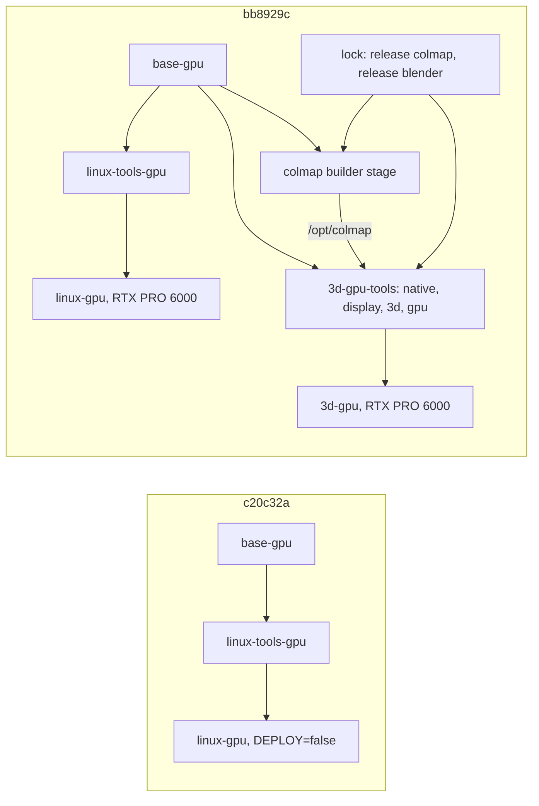

Incremental review of `main` from c20c32a to bb8929c (25 commits, about 2,700 changed lines without the generated `uv.lock`), following r3. Covers m3 (lolay/agent-images#92, #94, #99, #100, #103, #105, #106: `linux-gpu` and `3d-gpu` on the RTX PRO 6000), r3's remediation (#88 to #91), #93, #95, #96, #98, #102 and the bot's lock bumps. Register: `2026-11-14-r4-incremental-findings.md`.

## Review guide

Review tier: [skim], records only; the decisions below are the reading.
Verdict: 1 medium, 12 low, 1 info; 2 decisions for you. Nothing high. The verifier dropped 1 of 15.
Review time: ~6 min

m3's code holds up: the reviewers found no wrong behavior in the 3d toolset, the GPU deploy or r3's fixes, and all five of r3's claimed fixes go red under mutation. The gaps are at the edges of what the tests derive: the rule r3.f14 added doesn't see the new builder stage, and the GPU env-file check covers one type. Two findings (f6, f7) are mistakes in m3's own close-out docs.

## Fix now

- r4.f1 medium: delete `ARG COLMAP_VERSION` from the 3d-gpu Dockerfile and every test stays green; the build would take COLMAP's newest release, not the locked one

## Decisions for you

1. **r4.f10 The 3d toolset's apt packages and builder stage.** Now: COLMAP's dev packages (builder stage) and runtime libraries (a list generated at build) install from the snapshot but aren't in `packages.txt`, so the lock never records them, and the toolset needs the type's builder stage. Options: list the runtime libraries in `3d/packages.txt`, checked against the generated list (recommended), or amend the toolset contract and gcp.md's apt row to allow both.
2. **r4.f11 Seeding a new type's lock from a session.** Now: AGENTS.md says `make cloud-lock` on a Docker host; #103 seeded 3d-gpu's by hand from a session with no Docker. Options: a dispatchable one-type resolve in the lock watch (recommended, so lock.sh stays the only writer), or document the minimal hand seed in AGENTS.md.

## Since last review

## Rules changed

- Added, `AGENTS.md` "Tests that can fail": a test of a rule every runner type follows reads every type and every script a Dockerfile runs, never one named type (r3.f14, r4.f1, r4.f2).
- Recurred, no new rule: "One source per fact" (r4.f9, f12, f13, f14, after r3.f19 to f22). Four in a row suggests a check rather than another rule; not proposed yet.

Fix review

| Finding | Was | Now | By |
| --- | --- | --- | --- |
| r3.f1 | open | fixed | #89: carry drops a lock `main` changed |
| r3.f2 | open | fixed | #91: one `gcp_check_type`; the supervisor skips, not exits |
| r3.f10 | open | fixed | #88: a parent's lock isn't a child's input |
| r3.f13 | open | fixed | #90: the link refusal has symlink and FIFO tests |
| r3.f14 | open | fixed | #90, for `install-toolset.sh` stages; the builder stage gap is r4.f1 |
| r3.f16, f21 | open | open, grew | #103 added COLMAP and Blender (r4.f5, r4.f12) |
| the other 15 of r3 | open | open | code unchanged; r3.f8 and f11 locations corrected |
| all 24 of r1 | open | open | code unchanged at their locations |

Details by dimension

- **tests** (correctness and tests reviewers): r4.f2 low, only linux-gpu's env file is deployed in a test, so 3d-gpu can lose `LAUNCH_STAGE=BETA` silently; r4.f3 low, the carry test doesn't check an untouched lock is still carried; r4.f4 low, `make doctor`'s MODE mapping is untested; r4.f5 low, the colmap and blender pin arms are untested.
- **drift**: r4.f6 low, the docs say `/opt/3d` is root-owned, but the session user owns it, so a session can install into it; r4.f7 low, README says the GPU types are planned and both GPU env files cite a deleted handoff; r4.f8 low, gcp.md's lock tables and Makefile.md don't know COLMAP, Blender or the 3d `uv.lock`; r4.f9 low, the GPU target list is written three ways and only `sm_120` is checked.
- **duplication**: r4.f12 low, r3.f21 grew with two more release tools and copied lookups; r4.f13 low, toolset scripts restate install-toolset.sh's apt helpers; r4.f14 info, `NVIDIA_DRIVER_CAPABILITIES` is set per GPU Dockerfile.
- **correctness**: read every changed line; its findings merged into f1 and f10, and one (the watchdog's path prefix check) was dropped by the verifier as crossing no trust boundary.

Previously accepted, not raised again: r2.f16 (report and record paths spelled out in several places).

Assisted-by: Claude Code
