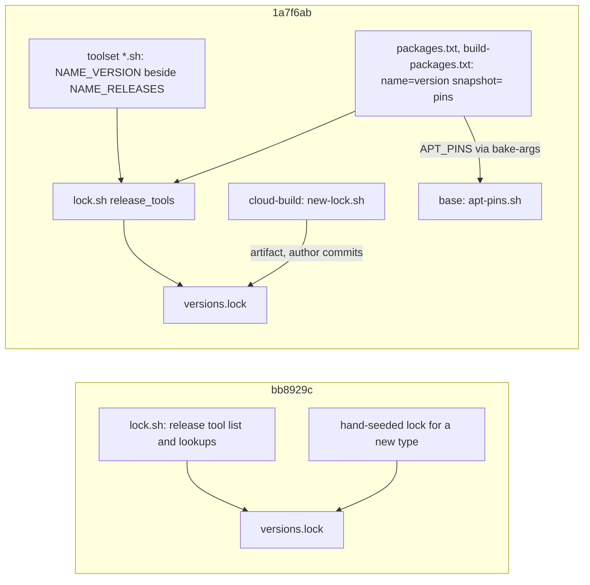

Incremental review of `main` from bb8929c to 1a7f6ab (29 commits, about 4,800 changed lines), following r4. Covers r4's remediation (lolay/agent-images#110, #112, #113, #120, #124, #125, #126, #132, #133), apt snapshot pins (#116, #121), Blender's mirrors (#114), #119, #135, #136 and the bot's lock bumps. Register: `2026-11-19-r5-incremental-findings.md`.

## Review guide

Review tier: [skim], records only; the decisions below are the reading.
Verdict: 1 medium, 12 low, 3 info; 3 decisions for you. Nothing high. The verifier dropped 1 of 18 and folded 2 into open findings.
Review time: ~6 min

r4's remediation holds: all 14 of r4's findings are fixed, and every test claim went red under mutation. r3.f3, f16 and f21 are fixed too. The new code is mostly sound; the one medium is a supply-chain regression in #114's Blender mirrors. The rest is docs and guards the fixes left behind, which this review turns into an AGENTS.md rule.

## Decisions for you

1. **r5.f1 Where Blender's checksum comes from.** Now: when blender.org refuses the runner, the tarball and its `.sha256` can both come from the same mirror, so the check proves nothing about origin. Proposed: the lock records the SHA-256 at resolve, from blender.org, and the build checks against it. Options: that (recommended), fetch only the `.sha256` from blender.org, or drop the mirrors.
2. **r5.f10 `make cloud-lock WRITE=1`.** Now: it writes a lock into the tree, while gcp.md now says no lock is written by hand. Options: keep it and document it as local-only, never committed (recommended, since a local build of a pin change needs it), or drop WRITE.
3. **r5.f13 The apt bootstrap, twice.** Now: the base Dockerfile and the lock's resolve each run update, ca-certificates, apt-pins and install by hand, and already differ on `--allow-downgrades`. Options: one `apt-prepare.sh [--simulate]` both call (recommended), or document the pair.

## Since last review

## Rules changed

- Added, `AGENTS.md` "One source per fact": when a change moves a fact to its one source, grep for the old value and fix every doc that states it in the same PR; a guard against a second copy matches the copy, not one spelling (r4.f6 to f8, r5.f7 to f9, r5.f14, f15).
- Recurred, no new rule: guards too narrow to fail (r5.f4, f5, f6, after r4.f1 to f5). "Tests that can fail" already covers it; the fixes did run their mutations, and missed the paths beside them.

Fix review

| Finding | Was | Now | By |
| --- | --- | --- | --- |
| r4.f1 to f14 | open | fixed | #110, #112, #113, #124, #125, #126, #133; all claims borne out, test claims red under mutation |
| r4.f10 | open (decision) | fixed | #110; the decision was only in #110's description, now recorded on #108 |
| r3.f3 | open | fixed | #120 |
| r3.f16 | open | fixed | #132, #125 (its red runs are CI's: the resolve tests skip in a session) |
| r3.f21 | open | fixed | #125, #133, no claim |
| r3.f11, f12 | open | open, partly fixed | #112, #125; #121 |
| r3.f4, f18, f19, f20 | open | open, grew | APT_PINS, 21 more skipped resolve tests, the watch's write loop moved, more list readers |
| the other 7 of r3 | open | open | code unchanged; locations corrected |
| all 24 of r1 | open | open | code unchanged; locations corrected; no decisions on #40 |

r4's leftovers became r5's own findings: f4 (r4.f1), f7 (r4.f9), f11 (r4.f10), f14 (r4.f12), f15 (r4.f13).

Details by dimension

- **correctness**: r5.f2 low, `blender.sh latest` can lock an older Blender from a lagging mirror, which auto-merges; r5.f3 info, `CUDA_CAPABILITIES` order is unchecked though PTX goes to the last entry.
- **tests**: r5.f4 low, `test_toolset_args` doesn't follow install.sh into the helper scripts lock.sh now locks versions from; r5.f5 low, release_latest's tag and script-name checks are untested; r5.f6 low, the `-gencode` loop and COLMAP's runtime list are untested, and check.txt checks SASS only.
- **drift**: r5.f7 low, image-toolsets.md's GPU lists are now wrong; r5.f8 low, apt-pins.sh and the base Dockerfile say APT_PINS comes from the lock, and gcp.md misses `lock.sh releases`; r5.f9 low, "Adding a type" lacks the first-lock step; r5.f11 low, the toolset contract doesn't name install-toolset.sh's helpers.
- **duplication**: r5.f12 low, two `# pinned:` readers disagree on spacing; r5.f14 low, tflint's `latest` bypasses `github_latest`; r5.f15 info, four install.sh print the log prefix by hand; r5.f16 info, both workflows set up Homebrew for `lock.sh resolve`.
- **dropped**: `lock-watch.sh types` as dead code (it's the class mapping's test seam). Folded: the re-spelled lock path into r3.f19, the list-line readers into r3.f20.

Previously accepted, not raised again: r2.f16 (report and record paths spelled out in several places).

Assisted-by: Claude Code
